# Dreamcore Vibe

Игра-прогулка для Android в ярком стиле **dreamcore / liminal**. Без разговоров и
субтитров: просто ходишь по странным, залитым светом местам и ищешь двери, которые
переносят тебя в следующий сон.

**Готовый APK:** [`dist/DreamcoreVibe.apk`](dist/DreamcoreVibe.apk). Скачай его на телефон
и установи (нужно разрешить «установку из неизвестных источников»).

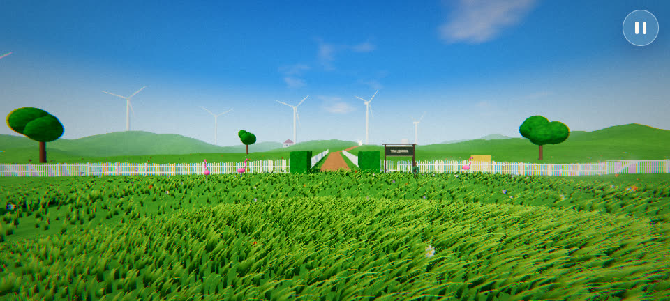

| | |
|---|---|
| 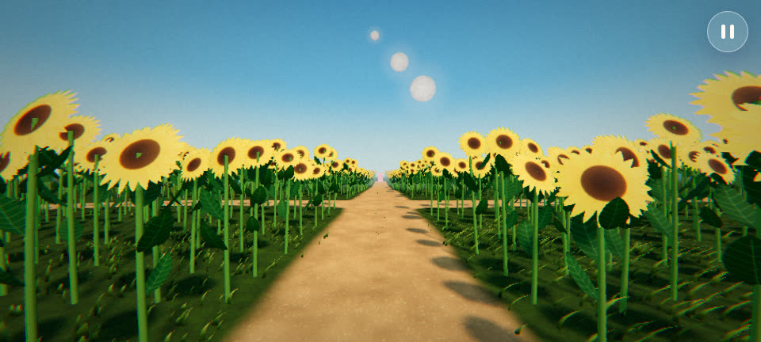 | 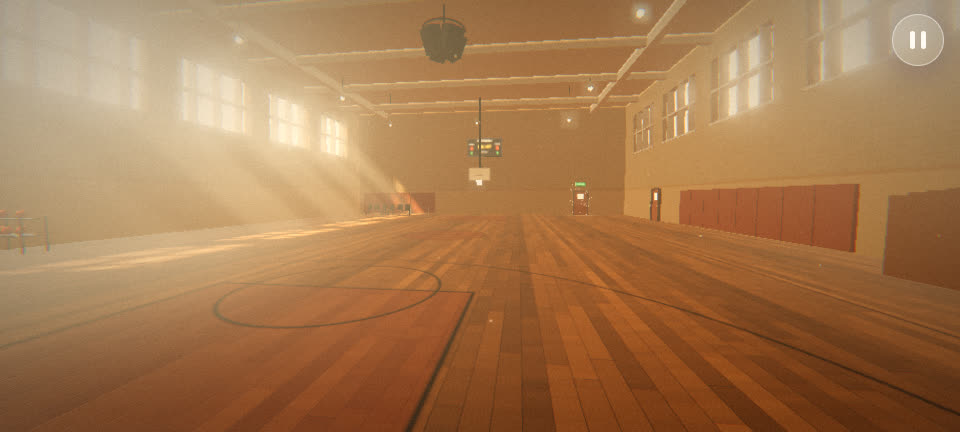 |
| 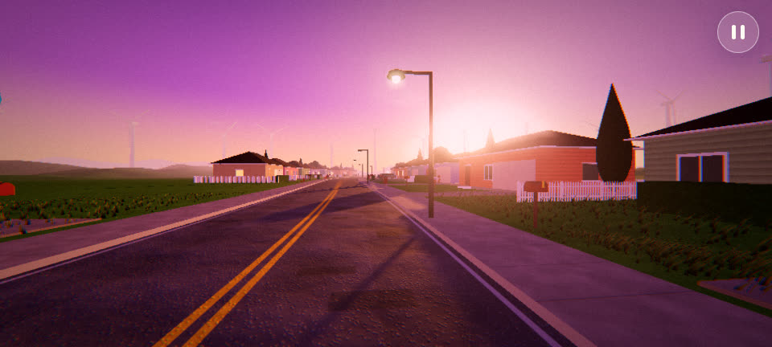 | 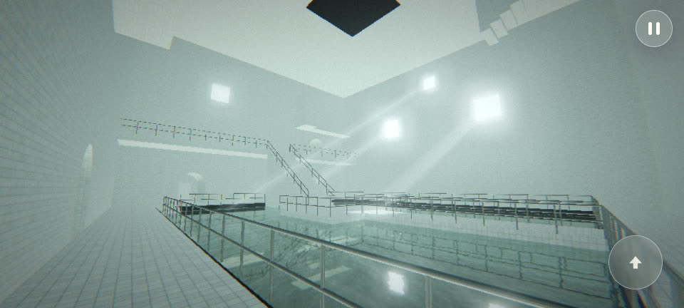 |
| 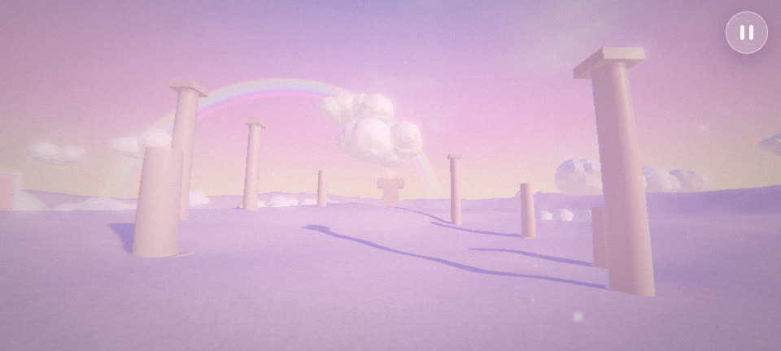 | 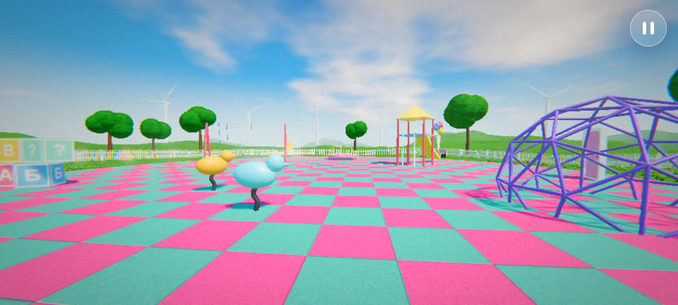 |
| 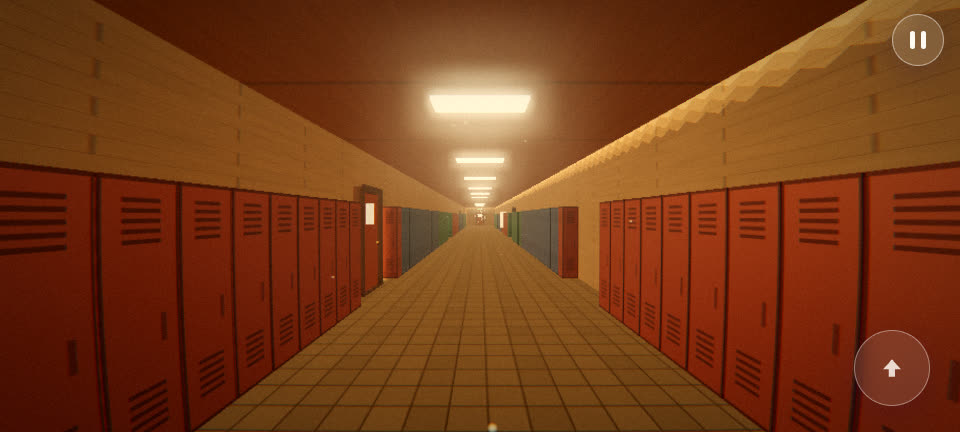 | 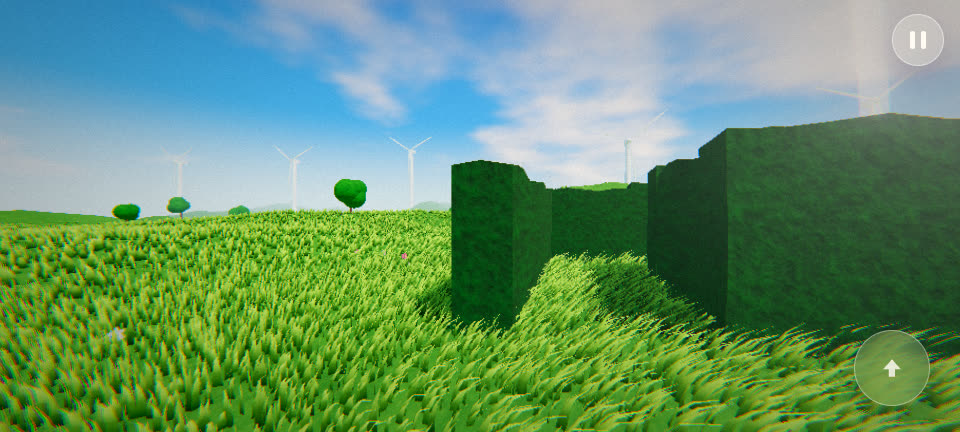 |
| 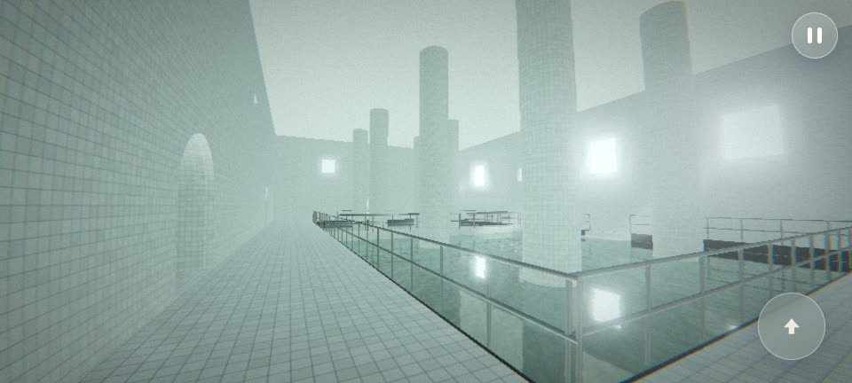 | 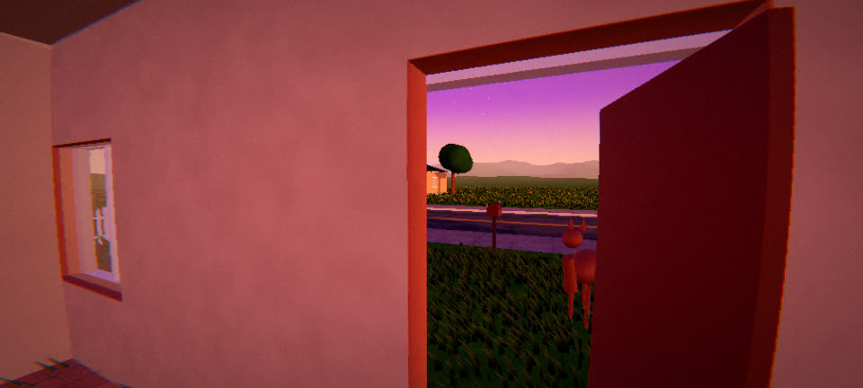 |
| 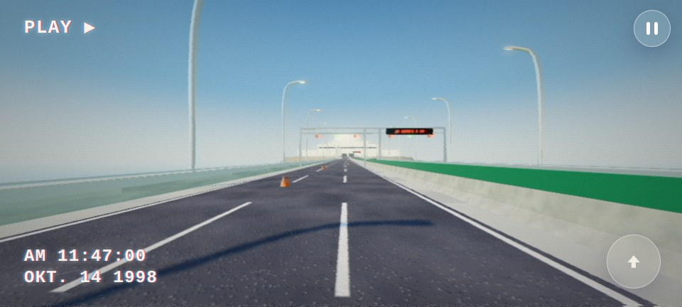 | 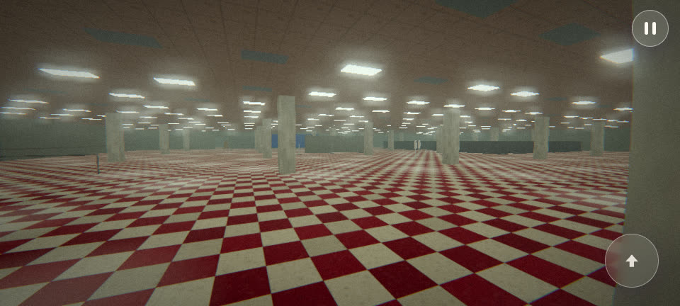 |
| 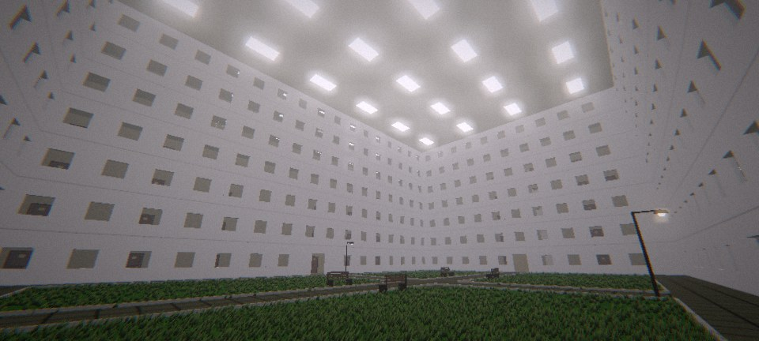 | 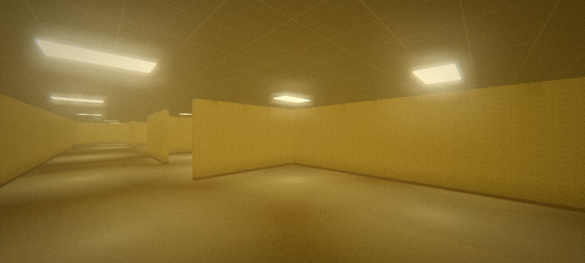 |
| 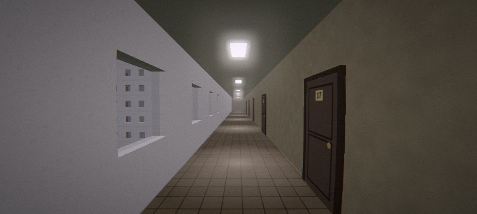 | |

## Уровни

| # | Название | Что там |
|---|----------|---------|
| I | Ты дома | Огромный луг (~470 м): холмы, белые заборчики, ферма, ветряки, до которых можно дойти, фламинго |
| II | Три луны | Бесконечное поле подсолнухов (~500 м) под тремя лунами. Через подсолнухи можно идти куда угодно, есть сеть тропинок и поляны |
| III | Пустой спортзал | Золотой час, лучи из окон, пыль в воздухе, а за залом длинный школьный коридор со шкафчиками |
| IV | Вечер, которого не было | Пригород на фиолетовом закате, дорога ~400 м, можно ходить по дворам и заходить в любой дом (гостиная, кухня или спальня) |
| V | Бассейны | Закрытый комплекс из белой плитки: сводчатые тоннели, атриум с тёмной водой, мостом и лестницей на балкон, длинный зал с каналом и колоннами, лестничная башня. Свет только из нескольких окон |
| VI | Над облаками | Пастельное небо, море облаков, руины колоннад, радуга и лестница в небо |
| VII | Площадка | Пустая детская площадка, качели качаются сами, рядом лабиринт из живой изгороди |
| VIII | Мост в никуда | Длинный мост над морем в солнечный день, снятый как на VHS-камеру (мягкая плёнка, «PLAY ▶» и дата в углу). Ряды изогнутых фонарей, табло с красными надписями, брошенные машины. Дорога проседает и снова поднимается, поэтому мост виден целиком до огромного здания с куполом на острове (~850 м) |
| IX | Пустой магазин | Огромный заброшенный магазин: красно-кремовая шахматная плитка, колонны, гудящие лампы (часть мигает), касса, балетный угол с зеркалами, склад |
| X | Двор-колодец | Двор, со всех сторон зажатый стенами с сотнями окон, а сверху вместо неба потолок с лампами. Можно подняться по двум лестницам на все 7 этажей и пройти по кольцевым коридорам с дверями квартир, глядя во двор через окна |
| XI | Подвал | Backrooms, Level 0: бесконечные комнаты с жёлтыми обоями, влажный ковёр, низкий подвесной потолок с неровно расставленными гудящими лампами (~140×140 м). Полная тишина, без музыки и звуков |

После одиннадцатой двери сон начинается заново.

## Управление

* **Левая половина экрана**: джойстик (появляется там, где коснулся). Если оттянуть
  дальше, персонаж бежит.
* **Правая половина**: обзор.
* **Кнопка со стрелкой**: прыжок (на ПК: пробел). В воду можно прыгать: брызги, круги на воде, в воде персонаж идёт медленнее.
* Кнопка **II** или «Назад» на телефоне: пауза.
* На ПК (для отладки): WASD, мышь, Shift для бега, Esc для паузы.

Двери сами открываются, когда подходишь к ним спереди (на своём этаже). На больших
открытых уровнях над настоящей дверью виден слабый столб света. Двери-обманки просто
не открываются. Открытие двери и переход через неё полностью беззвучные.

## Настройки

* **Графика**: Низкая / Средняя / Высокая / Ультра. Влияет на разрешение, тени,
  свечение (bloom), сглаживание, густоту и дальность травы и подсолнухов, отражения в воде.
  Трава рисуется тремя слоями детализации с плавным переходом: на Высокой и Ультра
  она густая до ~100 м вокруг игрока.
  Дополнительно включён адаптивный режим: если FPS проседает, разрешение немного
  снижается автоматически.
* Громкость музыки и звуков, чувствительность обзора, поле зрения (FOV), покачивание
  камеры, инверсия по Y, счётчик FPS.

## Музыка

* `drowsy.mp3`: «drowsy liminal dreamcore» (9jackjack8). Голоса нет, используется целиком (меню и уровень IV).
* `comfort.mp3`: Instupendo — Comfort Chain, фрагмент с 0:38 до конца (до 0:38 есть вокальные вставки).
* `sixfortyseven.mp3`: Instupendo — Six Forty Seven, только части без голоса (0:00–0:08 + 1:42–1:57).
* `numbers.mp3`: Temporex — Numbers, только инструментальные куски (1:13–1:42 + 1:45–2:02).
* `pastel_lullaby.mp3`, `aqua_halls.mp3`, `cloud_choir.mp3`, `fog_bridge.mp3`, `empty_mall.mp3`,
  `courtyard_night.mp3`: оригинальные эмбиент-треки,
  процедурно сгенерированные скриптом `tools/make_music.py` (без голоса).

Участки с вокалом определялись автоматически: трек раскладывался нейросетью Demucs
на голос и инструментал, и по энергии голосовой дорожки находились чистые места.

> ⚠️ Треки Instupendo и Temporex защищены авторским правом. Для личного использования
> всё в порядке, но перед публикацией игры (Google Play и т.п.) их нужно лицензировать
> или заменить на сгенерированные.

Фоновые звуки (ветер, море, птицы, капли в бассейнах) синтезируются в реальном
времени через WebAudio. Шагов не слышно нигде, двери тоже беззвучные. Единственный
звук от игрока: всплеск, когда прыгаешь или заходишь в воду.

## Как это устроено

* `web/src`: игра на **three.js** (WebGL2). Вся геометрия и текстуры процедурные:
  трава на GPU (десятки тысяч травинок с ветром), инстансинг подсолнухов, небо с
  облаками и лунами в шейдере, IBL-отражения, тени, постобработка (bloom, лёгкий
  «рыбий глаз», хроматическая аберрация, виньетка, зерно, цветокоррекция, FXAA на
  низкой и средней графике, VHS-плёнка на мосту).
* `android/`: минимальное нативное приложение: полноэкранный `WebView`, который
  отдаёт файлы игры из APK по виртуальному https-адресу.
* `tools/build-web.mjs`: сборка JS-бандла (esbuild) в `web/dist`.
* `tools/build-apk.sh`: сборка APK **без Gradle**, только Android SDK build-tools
  (aapt2 → javac → d8 → zipalign → apksigner).

### Сборка

```bash
npm install
npm run build            # web/dist
tools/build-apk.sh       # dist/DreamcoreVibe.apk (нужен ANDROID_HOME с build-tools 35 и platform android-35)
```

Для разработки в браузере: `npm run dev`, затем открыть http://localhost:8080.

GitHub Actions (`.github/workflows/build-apk.yml`) собирает APK на каждый push и
выкладывает его как артефакт сборки.

APK подписан ключом `android/dreamcore.keystore` (пароль `dreamcore`). Он подходит
для установки и обновления на своём телефоне. Для Google Play нужен собственный ключ.
